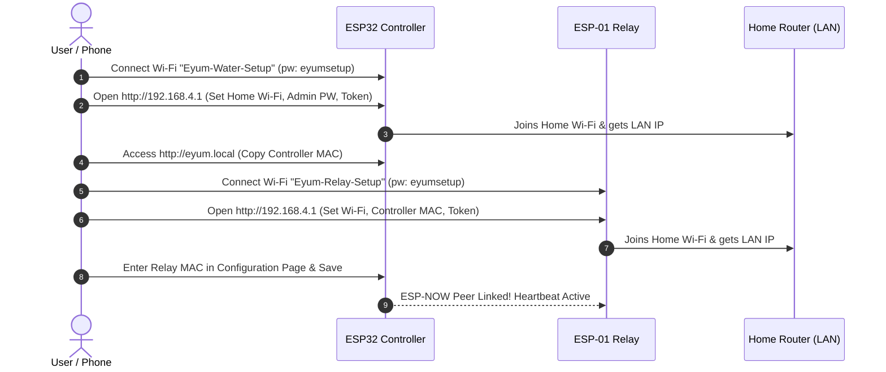

# 🚰 Eyum Water Automation

[](https://github.com/aditya2618/eyum-water-automation/actions/workflows/build.yml)
[](https://platformio.org/)
[](https://espressif.com/)
[](LICENSE)
[](CONTRIBUTING.md)

**Eyum Water Automation** is a cloud-free, peer-to-peer embedded automation system designed to manage overhead domestic water tanks safely and reliably. 

It splits the responsibilities across two dedicated microcontroller nodes connected over **ESP-NOW** and local Wi-Fi: an **ESP32** tank monitor that performs ultrasonic ranging, evaluates safety heuristics, and serves a modern local web dashboard; and a compact **ESP-01 (ESP8266)** relay node located near the motor pump to safely actuate the motor contactor.

---

## 🌟 Key Highlights

- **Zero Cloud Dependency:** Operates 100% locally on your home LAN. Internet outages never interrupt tank level monitoring or pump control.
- **Peer-to-Peer ESP-NOW Telemetry:** Sub-millisecond direct packet transmission between ESP32 and ESP-01 on matching Wi-Fi channels.
- **Fail-Safe Watchdogs:**
  - **30-second Relay Heartbeat:** The relay automatically de-energizes if the controller stops sending heartbeats for 30 seconds.
  - **Sensor Anomaly Detection:** Pump automatically cuts off after 3 consecutive invalid or out-of-range ultrasonic readings.
  - **Run-Time Limiter:** Enforces a configurable hard cutoff (e.g. 30 minutes) to prevent dry-running or flood damage.
- **Built-in Captive Portal Provisioning:** First-boot Wi-Fi hotspot setup portal (`Eyum-Water-Setup` and `Eyum-Relay-Setup`) — no hardcoding SSIDs or credentials in code.
- **Sleek Web Dashboard:** Dark-mode, mobile-responsive local dashboard served directly from the ESP32 SPIFFS/Flash with real-time level animations, manual override buttons, and live telemetry.
- **REST API Support:** Easy integration into Home Assistant, Node-RED, or custom home automation scripts.

---

## 🏗 System Architecture

```mermaid
flowchart TD
    subgraph TankNode["Overhead Tank Node"]
        SR04M["Waterproof Ultrasonic Sensor\n(JSN-SR04T / AJ-SR04M)"]
        ESP32["ESP32 DevKit V1\n(Tank Controller & Web Server)"]
        SR04M -->|Echo / Trig| ESP32
    end

    subgraph MotorNode["Pump Motor Enclosure"]
        ESP01["ESP-01 / ESP8266\n(Relay Node)"]
        RelayBoard["Relay Module / Contactor"]
        PumpMotor["220V AC Pump Motor"]
        ESP01 -->|GPIO 0| RelayBoard
        RelayBoard -->|AC Mains| PumpMotor
    end

    subgraph UserLAN["Local Wi-Fi Network"]
        Router((Home Wi-Fi Router))
        Browser["Phone / PC Browser\n(http://eyum.local)"]
        Browser <-->|HTTP / Web Dashboard| ESP32
    end

    ESP32 <-->|2.4 GHz Wi-Fi STA| Router
    ESP01 <-->|2.4 GHz Wi-Fi STA| Router
    ESP32 ===|ESP-NOW Encrypted Packet Stream\n(Heartbeat every 8s)| ESP01
```

---

## 📦 Repository Structure

```text
eyum-water-automation/
├── .github/
│   ├── workflows/build.yml     # Automated PlatformIO CI builds
│   ├── ISSUE_TEMPLATE/         # Bug reports and feature request templates
│   └── pull_request_template.md
├── src/
│   ├── tank_controller/
│   │   ├── tank_controller.ino # ESP32 firmware, web server, safety logic
│   │   └── dashboard.h         # Responsive HTML/CSS/JS dashboard UI
│   └── relay_node/
│       └── relay_node.ino      # ESP-01 firmware, failsafe watchdog
├── tools/
│   ├── build-firmware.ps1      # One-click build script for all nodes
│   ├── flash-esp32.ps1         # Upload helper for ESP32
│   ├── flash-esp01.ps1         # Upload helper for ESP-01
│   └── patch_ino.py            # PlatformIO INO filter build helper
├── platformio.ini              # Multi-target PlatformIO project configuration
├── CONTRIBUTING.md             # Contributor guidelines
├── LICENSE                     # MIT License
└── README.md
```

---

## 🛠 Hardware Bill of Materials (BOM)

| Component | Quantity | Purpose |
| --- | :---: | --- |
| **ESP32 DevKit V1 (38-pin)** | 1 | Tank controller, web dashboard host, safety engine |
| **ESP-01 / ESP-01S (ESP8266)** | 1 | Remote pump actuator receiver |
| **ESP-01 Relay Board** | 1 | 5V relay carrier for ESP-01 (controls motor or contactor) |
| **JSN-SR04T / AJ-SR04M** | 1 | Waterproof ultrasonic sensor (Trigger/Echo mode) |
| **Resistor 1 kΩ** (1/4W) | 1 | Upper leg of 5V → 3.3V Echo voltage divider |
| **Resistor 2 kΩ** (1/4W) | 1 | Lower leg of 5V → 3.3V Echo voltage divider |
| **5V / 2A Isolated Power Supply** | 2 | Clean power (one for Tank Node, one for Motor Node) |
| **Capacitors 470 µF / 10V & 0.1 µF** | 2 pairs | Buffer capacitors placed across 5V/GND near each Wi-Fi board |
| **AC Contactor (adequately rated)** | 1 | Motor power switching (driven by the relay) |
| **Momentary Push Button** | 1 (opt) | Connected to GPIO 23 to trigger factory settings reset |

---

## ⚡ Electrical & Wiring Specifications

### 1. ESP32 Controller & Ultrasonic Sensor

> ⚠️ **CRITICAL:** The JSN-SR04T requires 5V VCC, but ESP32 GPIOs are **not 5V tolerant**. You **must** install the voltage divider on the `ECHO` line.

```text
  JSN-SR04T                         ESP32 DevKit V1
┌───────────┐                      ┌───────────────┐
│       VCC ├──────────────────────┤ VIN (5V)      │
│       GND ├──────────┬───────────┤ GND           │
│      TRIG ├──────────┼───────────┤ GPIO 18       │
│           │          │           │               │
│      ECHO ├──[ 1kΩ ]─┴───┬───────┤ GPIO 19       │
└───────────┘              │       └───────────────┘
                        [ 2kΩ ]
                           │
                         (GND)
```

- **Reset Hotspot Button (Optional):** Wire a normally-open momentary switch between `GPIO 23` and `GND`. Pressing and holding for 8 seconds erases saved Wi-Fi configuration and restarts in AP hotspot setup mode.

### 2. ESP-01 Relay Node

- The ESP-01 relay module uses **GPIO 0** to trigger the relay.
- By default, `RELAY_ACTIVE_LOW` is set to `true` (standard for most ESP-01 relay shields). If your board is active-high, toggle `RELAY_ACTIVE_LOW = false` in `src/relay_node/relay_node.ino`.
- **Power requirements:** Supply regulated 3.3V to the ESP-01 (or 5V to the relay carrier board that has an onboard 3.3V LDO). Add a 470 µF electrolytic capacitor across power terminals to absorb Wi-Fi RF burst transients.
- **Mains Warning:** High-power inductive pump motors must be switched via a dedicated, certified AC contactor. Do not route heavy motor currents through miniature hobby PCB relays.

---

## 💻 Building and Flashing

### Option A: Using PlatformIO Core (Recommended)

1. **Build both firmware binaries:**
   ```powershell
   .\tools\build-firmware.ps1
   ```
   *(Or using PlatformIO CLI: `pio run`)*

2. **Flash the ESP32 Controller:**
   Connect the ESP32 via USB and run:
   ```powershell
   .\tools\flash-esp32.ps1 -Port COM5
   ```

3. **Flash the ESP-01 Relay Node:**
   Place the ESP-01 in flash-download mode (tie `GPIO 0` to `GND` during boot), connect your 3.3V USB-UART programmer, and run:
   ```powershell
   .\tools\flash-esp01.ps1 -Port COM7
   ```
   *Disconnect `GPIO 0` from `GND` after flashing and power cycle.*

4. **Monitor serial diagnostic logs (115200 baud):**
   ```bash
   pio device monitor -e esp32_controller --port COM5
   pio device monitor -e esp01_relay --port COM7
   ```

### Option B: Arduino IDE

1. Add board manager URLs in Arduino IDE:
   - `https://espressif.github.io/arduino-esp32/package_esp32_index.json`
   - `https://arduino.esp8266.com/stable/package_esp8266com_index.json`
2. Install **esp32 by Espressif** and **esp8266 by ESP8266 Community**.
3. Open `src/tank_controller/tank_controller.ino`, select **ESP32 Dev Module**, and upload.
4. Open `src/relay_node/relay_node.ino`, select **Generic ESP8266 Module**, and upload.

---

## 🚀 First-Time Provisioning Workflow



1. **Provision ESP32:**
   - Power on the ESP32. Join Wi-Fi network `Eyum-Water-Setup` (password: `eyumsetup`).
   - Open browser to `http://192.168.4.1`.
   - Enter your 2.4 GHz home Wi-Fi SSID, password, admin dashboard password, and a shared pairing token (8–16 characters). Save and reboot.
2. **Retrieve Controller MAC:**
   - Connect phone/PC to your home Wi-Fi. Open `http://eyum.local` (or the IP assigned by your router).
   - Sign in (User: `admin`, Password: the dashboard password configured in step 1).
   - Note the **Controller MAC** shown on screen.
3. **Provision ESP-01 Relay:**
   - Power on the ESP-01. Join `Eyum-Relay-Setup` (password: `eyumsetup`).
   - Open browser to `http://192.168.4.1`. Note the Relay MAC shown.
   - Enter your home Wi-Fi details, paste the **Controller MAC**, and enter the exact same **Pairing Token**. Save and reboot.
4. **Link Peer in Dashboard:**
   - On the ESP32 dashboard (`http://eyum.local`), open Configuration, enter the **Relay MAC**, set tank depth and thresholds, and save.
   - Within seconds, `Relay Status` will indicate connected with recent heartbeat acknowledgement!

---

## 🌐 Local REST API Reference

All API routes utilize HTTP Basic Authentication (`admin` : `<configured_password>`).

### 1. Get Live System Telemetry
`GET /api/status`

**Response (`200 OK`):**
```json
{
  "distance": 45.2,
  "level": 62.3,
  "pumpRequested": false,
  "relayOn": false,
  "mode": "auto",
  "mac": "24:6F:28:XX:XX:XX",
  "ip": "192.168.1.150",
  "relayAge": 3
}
```

### 2. Manual Override / Mode Control
`POST /api/control`
- **Body parameters:** `command=auto` | `command=on` | `command=off`

**Example (cURL):**
```bash
# Force start pump
curl -u admin:yourpassword -X POST http://eyum.local/api/control -d "command=on"

# Return to automatic level control
curl -u admin:yourpassword -X POST http://eyum.local/api/control -d "command=auto"
```

### 3. Read System Configuration
`GET /api/config`

**Response (`200 OK`):**
```json
{
  "tankDepthCm": 120,
  "sensorOffsetCm": 0,
  "startPercent": 25,
  "stopPercent": 95,
  "maxRunMinutes": 30,
  "relayMac": "5C:CF:7F:XX:XX:XX",
  "pairToken": "********"
}
```

---

## 🛡 Failsafe & Reliability Guarantees

| Failsafe Condition | Trigger Threshold | Automated Action |
| --- | --- | --- |
| **Relay Loss-of-Heartbeat** | > 30 seconds without valid controller frame | Relay immediately forces coil **OFF**. |
| **Relay Wi-Fi Disconnection** | Wi-Fi connection drops | Relay immediately forces coil **OFF** and reconnects. |
| **Sensor Echo Timeout / Disconnect** | 3 consecutive failed samples (30s) | Pump command cancelled, relay forced **OFF**. |
| **Run-Time Overrun Protection** | Continuous run exceeds `maxRunMinutes` | Pump shut down and mode forced to `off`. |
| **Dual-Threshold Hysteresis** | Separate `startPercent` & `stopPercent` | Eliminates rapid cycling around trigger thresholds. |
| **Pairing Token Authentication** | Packet header token mismatch | Unauthorized packets or other ESP-NOW nodes discarded. |

---

## 🤝 Contributing

Contributions, issues, and feature requests are welcome!
Please check our [Contributing Guidelines](CONTRIBUTING.md) and open issues or PRs following the provided templates.

---

## 📄 License

This project is licensed under the [MIT License](LICENSE) — free for personal, educational, and commercial use.
