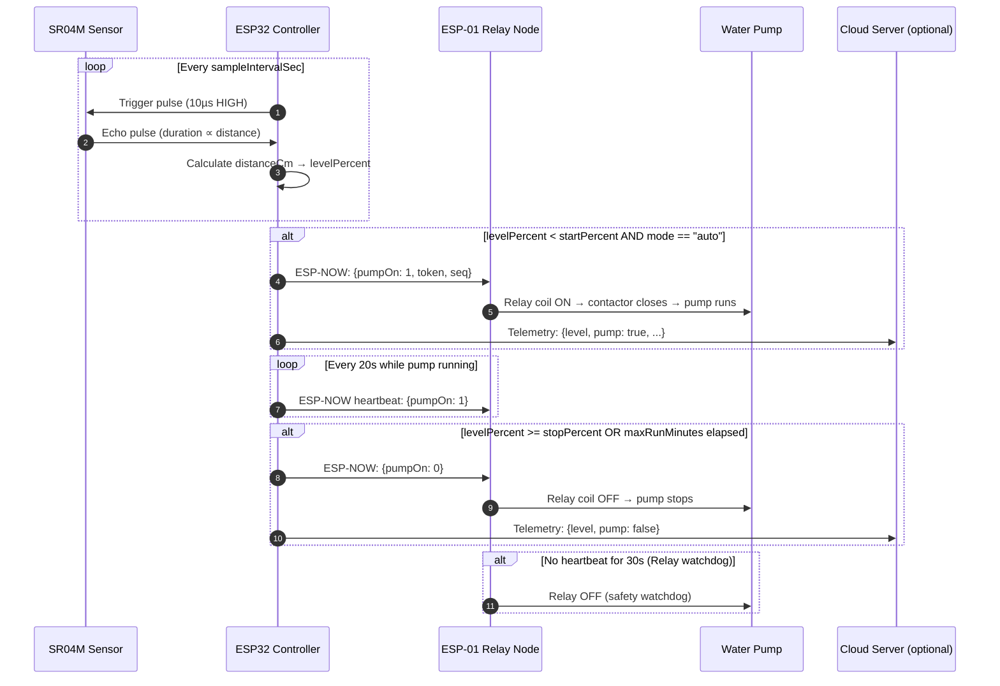
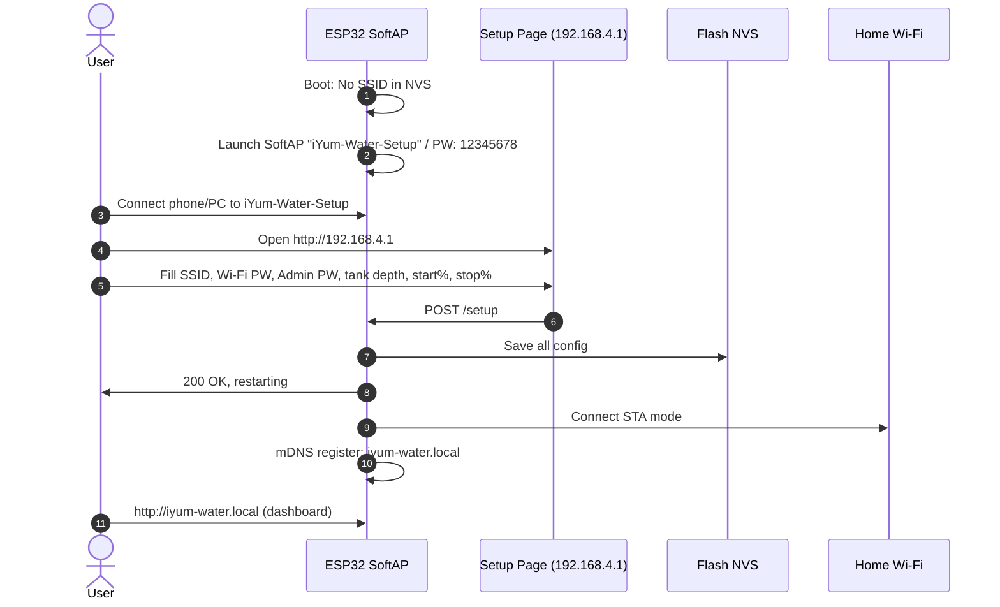

# iYum Water Automation — System Architecture & Engineering Documentation

## 1. System Overview

**iYum Water Automation** is a distributed, local-first overhead water-tank controller using two ESP boards that communicate over ESP-NOW (Wi-Fi peer-to-peer, no router required for the command link). It operates fully offline with no internet dependency.

```
+--------------------------------------------+       ESP-NOW (2.4 GHz, encrypted)
|  ESP32 DevKit V1 — Tank Controller         |<------------------------------+
|  - JSN-SR04M Ultrasonic (Trig/Echo)        |                               |
|  - Tank level measurement                  |                               |
|  - Pump start/stop decision logic          |      +------------------------+
|  - Browser dashboard (http://iyum-water.local)|   |  ESP-01 Relay Node        |
|  - Safety watchdog (max runtime, bad data) |      |  - ESP8266 on relay board |
|  - Cloud WebSocket client (optional)       |      |  - Switches pump contactor|
+--------------------------------------------+      |  - Independent watchdog   |
                                                    |    (30s heartbeat timeout)|
                                                    +---------------------------+
         INTERNET (optional, if cloud enabled)
  +--------------------------------------------------+
  |  Oracle Cloud Server (Django + Channels + Redis) |
  |  - /ws/iot/?device_id=X&secret=Y                |
  |  - REST API for remote control                   |
  +--------------------------------------------------+
```

---

## 2. Hardware Components

| Component | Part | Purpose |
|---|---|---|
| **Tank Controller** | ESP32 DevKit V1 (38-pin) | Measures tank level, runs pump logic, serves dashboard |
| **Relay Node** | ESP-01 / ESP-01S + Relay Board | Receives ESP-NOW commands, switches pump contactor |
| **Ultrasonic Sensor** | JSN-SR04T / SR04M (waterproof) | Tank level measurement via echo time |
| **Power — Controller** | 5V / 2A isolated supply or USB adapter | Powers ESP32 + sensor |
| **Power — Relay Node** | 5V / 2A isolated supply | Powers ESP-01 board |
| **Decoupling Caps** | 470µF / 10V electrolytic + 0.1µF ceramic | Wi-Fi burst stabilisation |
| **Voltage Divider** | 1kΩ + 2kΩ resistors | Attenuates 5V echo signal to 3.3V for ESP32 |

---

## 3. Hardware Wiring Schematic

### 3.1 ESP32 Tank Controller Pin Assignment

| Function | GPIO | Notes |
|---|---|---|
| **Ultrasonic TRIGGER** | GPIO 18 | Output, 3.3V digital |
| **Ultrasonic ECHO** | GPIO 19 | Input (via 1kΩ/2kΩ divider from 5V sensor) |
| **Setup Button** | GPIO 23 | Pull LOW for 8 seconds to wipe Wi-Fi NVS |

> **Voltage divider required** — SR04M echo pin outputs 5V logic. Use a 1kΩ resistor from echo → GPIO19, and 2kΩ from GPIO19 → GND. This creates a ~3.3V safe level for the ESP32 input.

### 3.2 ESP-01 Relay Node

- The ESP-01's onboard relay is controlled by the firmware listening to ESP-NOW commands.
- Relay coil driven by the ESP-01 GPIO pin (varies by relay board model).
- Pump motor side uses a properly rated mains contactor (not directly on the relay).

```
220-240V AC mains
   │
   ├─► Certified 5V/2A supply → ESP32 VIN + SR04M VCC
   │
   └─► Certified 5V/2A supply → ESP-01 relay board
                                         │
                                         └─► Contactor coil (mains-rated)
                                                    │
                                          Pump motor (mains-rated)
```

---

## 4. Software Architecture

### 4.1 ESP32 Tank Controller Modules

```
esp32.ino
├── Config struct              — All settings: SSID, depth, start%, stop%, maxRunMinutes, sampleSec
├── loadConfig() / saveConfig()— Preferences NVS read/write (namespace: "iyum-water")
├── startProvisioning()        — SoftAP + DNS captive portal (setup page at 192.168.4.1)
├── sampleTank()               — Ultrasonic HC-SR04 distance → water level %
├── sendRelayCommand()         — ESP-NOW packet to relay node (pump ON/OFF)
├── auto-pump logic            — levelPercent < startPercent → pump ON, >= stopPercent → pump OFF
├── WebServer routes           — Dashboard, /api/status, /api/config, /api/mode, /api/relay
├── CloudClient                — WebSocket to Oracle Cloud (optional, controlled via dashboard)
└── Serial console commands    — SET_WIFI:SSID,pass | RESET | STATUS
```

### 4.2 ESP-01 Relay Node Modules

```
relay_node.ino
├── loadConfig() / saveConfig()— Preferences NVS (namespace: "iyum-relay")
├── startProvisioning()        — SoftAP (SSID: "iYum-Relay-Setup") for pairing setup
├── ESP-NOW receive callback   — Validates token, drives relay pin
├── Watchdog timer             — Relay OFF if no heartbeat within 30s from controller
└── Status LED                 — Visual feedback of relay state
```

---

## 5. Data Flow Diagrams

### 5.1 Normal Pump Cycle



### 5.2 First-Run Provisioning



---

## 6. NVS Configuration Schema

Settings stored in ESP32 Non-Volatile Storage (NVS), namespace `"iyum-water"`:

| NVS Key | Type | Default | Description |
|---|---|---|---|
| `ssid` | string | `""` | Home Wi-Fi network name |
| `pass` | string | `""` | Home Wi-Fi password |
| `admin` | string | `""` | Dashboard admin password |
| `relaymac` | string | `""` | ESP-01 relay node MAC address (for ESP-NOW) |
| `token` | string | `""` | Shared pairing token (8–16 chars) |
| `depth` | int | `120` | Total tank depth in cm |
| `offset` | int | `0` | Sensor mounting offset from tank top (cm) |
| `start` | int | `25` | Start pump below this water level % |
| `stop` | int | `95` | Stop pump at this water level % |
| `maxrun` | int | `30` | Maximum pump run time in minutes |
| `sampleSec` | int | `10` | Sensor measurement interval in seconds |

---

## 7. REST API Specification

All authenticated endpoints use HTTP Basic Auth (username: `admin`, password: configured).

### `GET /api/status`
Returns live tank level and system state.
```json
{
  "level": 62.5,
  "distanceCm": 45.0,
  "pumpRequested": false,
  "relayReportedOn": false,
  "mode": "auto",
  "tankDepthCm": 120,
  "startPercent": 25,
  "stopPercent": 95,
  "relayMac": "AA:BB:CC:DD:EE:FF",
  "rssi": -58,
  "uptime": 7200,
  "ip": "192.168.29.71"
}
```

### `POST /api/config`
Update tank settings.
```json
{
  "tankDepthCm": 150,
  "startPercent": 20,
  "stopPercent": 90,
  "maxRunMinutes": 45,
  "sampleIntervalSec": 15,
  "relayMac": "AA:BB:CC:DD:EE:FF"
}
```

### `POST /api/mode`
Set pump mode.
```json
{"mode": "auto"}   // or "on" or "off"
```

### `GET /api/relay`
Returns current relay node pairing status.

---

## 8. ESP-NOW Protocol

ESP-NOW is a Wi-Fi peer-to-peer protocol. The controller sends a packed struct to the relay's MAC address:

```c
struct __attribute__((packed)) RelayMessage {
  char token[17];   // Shared pairing token (must match relay NVS)
  uint8_t type;     // 1 = command, 2 = relay ACK
  uint8_t pumpOn;   // 1 = pump ON, 0 = pump OFF
  uint32_t sequence;// Monotonically increasing counter
};
```

**Relay safety rules:**
- Token must match exactly (no match → ignore)
- Relay turns OFF if no heartbeat received within **30 seconds**
- Relay turns OFF if Wi-Fi disconnects
- Max run enforced independently on controller side

---

## 9. Cloud Integration (Optional)

The ESP32 tank controller has an optional WebSocket cloud client (`CloudClient.h/cpp`).

**Cloud connection:** `ws://<cloud-host>/ws/iot/?device_id=<id>&secret=<token>`

**Telemetry sent every 30s when connected:**
```json
{
  "type": "telemetry",
  "payload": {
    "level": 62.5,
    "pump": false,
    "mode": "auto",
    "rssi": -58,
    "uptimeSec": 7200,
    "fw": "1.3.0"
  }
}
```

**Cloud commands received:**
| Action | Effect |
|---|---|
| `pump_on` | Force pump ON (sends relay command) |
| `pump_off` | Force pump OFF |
| `set_mode` | Set mode: auto/on/off (`params.mode`) |

---

## 10. Safety Algorithms

1. **Relay Watchdog (30s):** If the controller crashes or loses connectivity, the relay node automatically cuts pump power after 30 seconds without a valid heartbeat — no flooding risk.
2. **Bad Data Cutoff:** After `INVALID_SAMPLE_LIMIT` (3) consecutive invalid ultrasonic readings (NaN / out-of-range), the pump is forced OFF to prevent running on bad data.
3. **Maximum Runtime:** Pump cannot run longer than `maxRunMinutes` (default: 30 min) per cycle regardless of sensor data.
4. **Token Authentication:** All ESP-NOW commands include a shared 8–16 char token. Relay ignores any packet with a non-matching token.
5. **Sequence Number:** Monotonically increasing `sequence` field in each packet prevents replay of old captured packets.

---

## 11. Multi-Board Summary

| Board | Firmware | Role | Key Peripherals |
|---|---|---|---|
| ESP32 DevKit V1 (38-pin) | `src/esp32/esp32.ino` | Tank controller, dashboard, cloud | GPIO 18/19 (sonar), GPIO 23 (button) |
| ESP32-C3 Super Mini | `src/esp32c3mini/esp32c3mini.ino` | Alternative controller | GPIO 0/1 (sonar), GPIO 9 (BOOT) |
| ESP-01 / ESP8266 | `src/relay_node/relay_node.ino` | Relay switch, watchdog | GPIO (relay coil), ESP-NOW |
